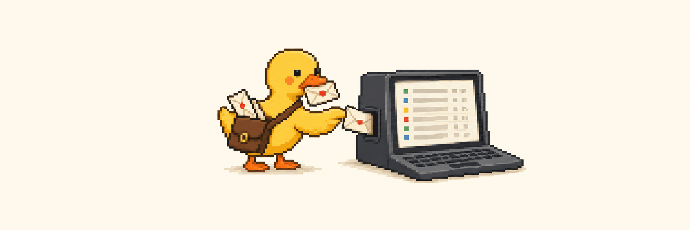

# Gmail to DuckDB



Inspired by: https://github.com/marcboeker/gmail-to-sqlite

Gmail to DuckDB copies your Gmail into one file on your computer. You can then search and read your mail in a local web page. The tool only reads Gmail. It does not send, change, or delete mail.

**What it does not do:**

- It does not upload your mail to a different service. Programs that you run, for example AI agents, can send query results to other places.
- It is not a backup. It does not keep attachments or the original message files, and it cannot restore mail to Gmail. For a full backup, use [Got Your Back](https://github.com/GAM-team/got-your-back).

## Before you start

You need:

- A Gmail account (an `@gmail.com` account, or a Google Workspace account that your administrator allows).
- A computer with one of these systems: macOS on Apple silicon (M1 or later), Linux on x86-64 or ARM64, or Windows on x86-64. Macs with an Intel processor are not supported.
- A terminal. On macOS, open **Terminal**. On Windows, open **PowerShell**. On Linux, open your terminal program.
- Approximately 20 minutes.

In this guide, type each command on one line in the terminal. Then push Enter.

## Step 1: Install the tool

**macOS or Linux with Homebrew (recommended on macOS).** If you do not have Homebrew, install it from [brew.sh](https://brew.sh). Then type:

```bash
brew tap ashwath-ramesh/gmail-to-duckdb https://github.com/ashwath-ramesh/gmail-to-duckdb
brew trust --formula ashwath-ramesh/gmail-to-duckdb/gmail-to-duckdb
brew install gmail-to-duckdb
```

If Homebrew says that `trust` is not a command, type `brew update`, and then do this step again.

**Linux without Homebrew.** Type `uname -m`. If the result is `x86_64`, use `amd64` in the commands below. If the result is `aarch64`, use `arm64`.

```bash
curl -LO https://github.com/ashwath-ramesh/gmail-to-duckdb/releases/latest/download/gmail-to-duckdb-linux-amd64.tar.gz
curl -LO https://github.com/ashwath-ramesh/gmail-to-duckdb/releases/latest/download/gmail-to-duckdb-linux-amd64.tar.gz.sha256
sha256sum -c gmail-to-duckdb-linux-amd64.tar.gz.sha256
tar -xzf gmail-to-duckdb-linux-amd64.tar.gz
mkdir -p ~/.local/bin
mv gmail-to-duckdb ~/.local/bin/
```

The `sha256sum` command must show `OK`. If it does not show `OK`, do not use the file.

**macOS without Homebrew.**

```bash
curl -LO https://github.com/ashwath-ramesh/gmail-to-duckdb/releases/latest/download/gmail-to-duckdb-darwin-arm64.tar.gz
tar -xzf gmail-to-duckdb-darwin-arm64.tar.gz
sudo mkdir -p /usr/local/bin
sudo mv gmail-to-duckdb /usr/local/bin/
```

If you downloaded the file with a web browser, macOS can block it. To unblock it, type `xattr -d com.apple.quarantine /usr/local/bin/gmail-to-duckdb`.

**Windows.** Type these commands in PowerShell:

```powershell
Invoke-WebRequest https://github.com/ashwath-ramesh/gmail-to-duckdb/releases/latest/download/gmail-to-duckdb-windows-amd64.zip -OutFile gmail-to-duckdb.zip
Expand-Archive gmail-to-duckdb.zip -DestinationPath $HOME\gmail-to-duckdb
Unblock-File $HOME\gmail-to-duckdb\gmail-to-duckdb.exe
[Environment]::SetEnvironmentVariable("Path", [Environment]::GetEnvironmentVariable("Path", "User") + ";$HOME\gmail-to-duckdb", "User")
```

Close PowerShell, and then open it again.

**Check the install.** Type `gmail-to-duckdb --help`. The terminal shows a list of commands. If the terminal says "command not found", close the terminal, open it again, and type the command again.

To build from source, see [Build from source](#build-from-source).

## Step 2: Make your Google sign-in file

Google requires each user to have a sign-in file (an "OAuth client") for programs that read Gmail. You make this file one time. Do not use a file from a different person.

CAUTION: Use the same Google account in this step and in Step 4. A Personal app accepts only the account that made it.

1. In your web browser, open [console.cloud.google.com/auth/overview/personal](https://console.cloud.google.com/auth/overview/personal).
2. Sign in with the Gmail account that you want to copy.
3. Select or create a project. You can keep the default name, `personal-mode-app`.
4. For the application type, select **Desktop app**.
5. Accept the Terms of Service. Then click **Continue**.
6. In the **OAuth client created** window, click **Download JSON**. The file name usually starts with `client_secret_`.
7. Open [the Gmail API page](https://console.cloud.google.com/apis/library/gmail.googleapis.com).
8. Make sure that the project from item 3 shows at the top of the page.
9. Click **Enable**.

A Personal app does not show the "Google hasn't verified this app" page. Its sign-in does not stop after 7 days.

**If you cannot use a Personal app** (for example, your Workspace administrator blocks it), use an External app:

1. Open [console.cloud.google.com/projectcreate](https://console.cloud.google.com/projectcreate) and create a project.
2. Enable the Gmail API, as in items 7 to 9 above.
3. Open [Google Auth Platform](https://console.cloud.google.com/auth/overview). Click **Get started**. Type an app name and your email address.
4. For **Audience**, select **External**. On a Workspace account where only your organization signs in, you can select **Internal**.
5. Open **Audience**. Under **Test users**, click **Add users**. Add your own Gmail address.
6. Open **Clients**. Click **Create client**. Select **Desktop app**. Click **Create**, and then download the JSON file.

NOTE: An External app in **Testing** stops your sign-in after 7 days. Google then shows `invalid_grant`. To sign in again, see [Problems and fixes](#problems-and-fixes).

## Step 3: Connect the sign-in file

Type this command. Use the path and the name of the file that you downloaded.

```bash
gmail-to-duckdb init --credentials ~/Downloads/client_secret_EXAMPLE.json
```

On Windows, type the path as `$HOME\Downloads\client_secret_EXAMPLE.json`.

The tool keeps a private copy of the file. You can then delete the file in your Downloads folder. The tool keeps its files in these folders:

- Settings and the sign-in file: `~/.config/gmail-to-duckdb/`
- Your mail copy: `~/.local/share/gmail-to-duckdb/`

On Windows, `~` is your user folder, for example `C:\Users\YourName`.

## Step 4: Start the tool and sign in

Type:

```bash
gmail-to-duckdb serve --sync-every 5m
```

This is what you see:

1. Your browser opens a Google sign-in page. If no browser opens, copy the link from the terminal into your browser.
2. Select your Google account.
3. For an External app only: Google shows "Google hasn't verified this app". Click **Advanced**, and then click **Go to** your app name. This is safe because you made the app.
4. Google asks for permission to read your email. Keep that box selected. Click **Continue**.
5. The browser shows "Signed in. You can close this tab."
6. A new browser tab opens your mail page.

The first sync copies the sender, subject, date, labels, and a short preview of each message. For a large mailbox, this can take a long time. The mail page shows the progress. After the first sync, the tool copies new changes every 5 minutes.

CAUTION: Keep this terminal open. If you close it, the tool stops. Use a second terminal for all other commands.

## Step 5: Check the setup

Open a second terminal. Type:

```bash
gmail-to-duckdb doctor
```

Each line starts with `ok`, `pending`, or `FAIL`. `pending` means that a step did not occur yet, for example the first sign-in. A `FAIL` line tells you the problem.

## Daily use

**Open the mail page again.** While `serve` runs, type `gmail-to-duckdb ui`. Each link works one time, for 2 minutes. Your browser stays signed in until `serve` stops.

**Search.** Type words in the search box. A message must contain all the words. You can also use these filters:

| Filter | Example | Finds |
|---|---|---|
| `from:` | `from:alice` | Messages from a sender that contains "alice" |
| `to:` | `to:bob` | Messages to or copied to "bob" |
| `subject:` | `subject:"payment received"` | Messages with this text in the subject |
| `unread` | `unread invoice` | Unread messages only |
| `after:` | `after:2024-01-01` | Messages on or after this date (UTC) |
| `before:` | `before:2024-06-01` | Messages before this date (UTC) |

In the terminal, type `gmail-to-duckdb search "from:alice invoice"`. The terminal shows 50 results at most.

**Message text.** The sync does not download the text of each message. To download the text of one message, open it and click **Fetch body**. To download the text of all messages, type `gmail-to-duckdb sync --bodies`. This uses more disk space and takes more time. Search finds words in the message text only after the download.

**Stop the tool.** In the terminal where `serve` runs, push Ctrl+C. To start it again, type the `serve` command from Step 4.

**Use a different port.** If port 8080 is not available, type `gmail-to-duckdb serve --sync-every 5m --port 8090`.

**Update the tool.** With Homebrew, type `brew update` and then `brew upgrade gmail-to-duckdb`. After an update, stop `serve` and start it again.

## Problems and fixes

| What you see | What to do |
|---|---|
| `invalid_grant` or `oauth refresh token rejected` | Google stopped your sign-in. This occurs after 7 days in Testing, after a password change, or when you remove access. Stop `serve`. Delete only the file `~/.local/share/gmail-to-duckdb/mail.token.json`. Start `serve` again and sign in with the same account. Do not delete the database. |
| `Google did not give Gmail read access` | You cleared the Gmail box on the Google page. Start `serve` again. On the Google page, keep the box selected. |
| `Error 403: access_denied` on the Google page | Your account is not a test user of an External app. Add it on the **Audience** page (Step 2), or use a Personal app. |
| `Signed out. Open the link that serve printed` | Type `gmail-to-duckdb ui` to get a new link. |
| `serve (pid N) does not answer` | An old `serve` is frozen. Close its terminal, or stop that process. Then try again. |
| `address already in use` | A different program uses the port. Add `--port 8090` to the command. |
| `config ... is not valid JSON` | Type the `init` command from Step 3 again. |
| macOS: "cannot be opened because Apple cannot check it" | Type `xattr -d com.apple.quarantine /usr/local/bin/gmail-to-duckdb`. |
| Windows: "Windows protected your PC" | Type `Unblock-File $HOME\gmail-to-duckdb\gmail-to-duckdb.exe`. |

**Use the tool on a remote computer.** Do this when the tool runs on a remote computer and your browser runs on your laptop. On your laptop, connect with two SSH tunnels:

```bash
ssh -L 41807:127.0.0.1:41807 -L 8080:127.0.0.1:8080 USER@REMOTE
```

In that SSH session, type `gmail-to-duckdb serve --sync-every 5m --no-browser`. Then copy the links from the remote terminal into your laptop browser. If the sign-in tab cannot connect, copy the full address from that tab. Paste it into the remote terminal, and push Enter.

## Privacy and safety

- Your mail copy is on this computer only. The files are not encrypted. Only your user account can open them. To protect them, turn on disk encryption (FileVault on macOS, BitLocker on Windows, or LUKS on Linux).
- The mail page is available only on this computer, and only through a one-time login link.

CAUTION: On a shared computer, an administrator can read your mail copy. Do not use the tool on a computer that you do not trust.

- Do not share these files, and do not put them in Git or a cloud folder: `credentials.json`, `*.token.json`, `*.serve.json`, `*.duckdb`, and `*.duckdb.search`.

**Remove all local data.** Stop `serve`. Then delete these two folders:

- `~/.config/gmail-to-duckdb/`
- `~/.local/share/gmail-to-duckdb/`

To also remove its access to your Google account, open [myaccount.google.com/permissions](https://myaccount.google.com/permissions). Select the app that you made in Step 2, and then click **Remove access**.

Full protection details: [docs/security.md](docs/security.md).

## For scripts and AI agents

Every command has a `--json` option. Email text in the results is untrusted. Read [docs/agents.md](docs/agents.md) before you connect an AI agent. All commands, flags, search rules, and the database schema are in [docs/reference.md](docs/reference.md).

## Build from source

You need [Go](https://go.dev/dl/) (the version in `go.mod`) and a C compiler. On a Mac, type `xcode-select --install` to get the compiler. On Linux, install `gcc`. On Windows, install MinGW.

```bash
git clone https://github.com/ashwath-ramesh/gmail-to-duckdb.git
cd gmail-to-duckdb
CGO_ENABLED=1 go build -o gmail-to-duckdb ./cmd/gmail-to-duckdb
```
